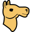
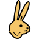
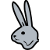
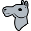

<a id="top"></a>

<div align="center">

<p>
  
  
  
  
  
  
</p>

# Arimaa

Motor de reglas e interfaz gráfica de escritorio en [Python](https://www.python.org/) para el juego de estrategia abstracta [Arimaa](https://es.wikipedia.org/wiki/Arimaa).

[](https://www.python.org/downloads/)
[](interfaz.py)
[](tests.py)
[](cubrimiento.py)
[](cubrimiento.py)
[](https://www.dc.uba.ar/)

<p>
  <a href="#descripcion">Descripción</a> ·
  <a href="#caracteristicas">Características</a> ·
  <a href="#reglas">Reglas y Tablero</a> ·
  <a href="#instalacion">Instalación</a> ·
  <a href="#testing">Testing y Cobertura</a> ·
  <a href="#autor">Autor</a>
</p>

</div>

---

<a id="descripcion"></a>

## Descripción

Implementación completa de la lógica de dominio y aplicación de escritorio de **[Arimaa](http://arimaa.com/arimaa/)**, desarrollada a partir de una especificación formal de primer orden en el marco de **Introducción a la Programación** ([Departamento de Computación](https://www.dc.uba.ar/) — [FCEyN, UBA](https://exactas.uba.ar/)).

El proyecto separa estrictamente la definición de tipos algebraicos ([`definiciones.py`](definiciones.py)), el motor de transición de estados libre de efectos colaterales ([`arimaa.py`](arimaa.py)) y la presentación visual interactiva ([`interfaz.py`](interfaz.py)), respaldados por una suite exhaustiva de pruebas unitarias de caja blanca ([`tests.py`](tests.py)).

---

<a id="caracteristicas"></a>

## Características

- **Inmutabilidad de estado** ([`arimaa.py`](arimaa.py)): Las operaciones de validación y movimiento preservan intactas las estructuras de entrada, retornando nuevas instancias de [`Juego`](definiciones.py#L163) en cada transición.
- **Implementación íntegra del reglamento**: Soporte para desplazamientos ortogonales, **empuje** (*push*), **arrastre** (*pull*), **congelamiento** (*freeze*) por superioridad de fuerza, descongelamiento mediante piezas aliadas y **activación secuencial de trampas**.
- **Interfaz gráfica de escritorio** ([`interfaz.py`](interfaz.py)): Construida con [`tkinter`](https://docs.python.org/3/library/tkinter.html), incluye selección contextual de casillas, historial completo de jugadas (*Undo* / *Redo*), indicadores de turno y carga de tableros personalizados desde archivos de texto ([`ejemplo_tablero/tablero.txt`](ejemplo_tablero/tablero.txt)).
- **Tipado estático estricto** ([`definiciones.py`](definiciones.py)): Modelado mediante [`Enum`](https://docs.python.org/3/library/enum.html), [`NamedTuple`](https://docs.python.org/3/library/typing.html#typing.NamedTuple) y anotaciones de tipos verificables con [`mypy`](https://mypy-lang.org/).
- **Cobertura verificada** ([`tests.py`](tests.py), [`cubrimiento.py`](cubrimiento.py)): **107 casos de prueba** automatizados con [`unittest`](https://docs.python.org/3/library/unittest.html), alcanzando **100.00 %** de cobertura de líneas y **98.96 %** de cobertura de ramas.

---

<a id="reglas"></a>

## Reglas y Tablero

Arimaa enfrenta a dos jugadores (**Dorado** y **Plateado**) sobre una grilla de `8 × 8` casillas con **cuatro casillas trampa** situadas en `(2, 2)`, `(2, 5)`, `(5, 2)` y `(5, 5)` (coordenadas `c3`, `f3`, `c6` y `f6`, indicadas con `×`).

### Disposición Inicial

<div align="center">

<table>
  <thead>
    <tr>
      <th></th>
      <th align="center">a</th>
      <th align="center">b</th>
      <th align="center">c</th>
      <th align="center">d</th>
      <th align="center">e</th>
      <th align="center">f</th>
      <th align="center">g</th>
      <th align="center">h</th>
    </tr>
  </thead>
  <tbody>
    <tr>
      <td align="center"><b>8</b></td>
      <td align="center"></td>
      <td align="center"></td>
      <td align="center"></td>
      <td align="center"></td>
      <td align="center"></td>
      <td align="center"></td>
      <td align="center"></td>
      <td align="center"></td>
    </tr>
    <tr>
      <td align="center"><b>7</b></td>
      <td align="center"></td>
      <td align="center"></td>
      <td align="center"></td>
      <td align="center"></td>
      <td align="center"></td>
      <td align="center"></td>
      <td align="center"></td>
      <td align="center"></td>
    </tr>
    <tr>
      <td align="center"><b>6</b></td>
      <td align="center">·</td>
      <td align="center">·</td>
      <td align="center" title="Casilla trampa c6"><b>×</b></td>
      <td align="center">·</td>
      <td align="center">·</td>
      <td align="center" title="Casilla trampa f6"><b>×</b></td>
      <td align="center">·</td>
      <td align="center">·</td>
    </tr>
    <tr>
      <td align="center"><b>5</b></td>
      <td align="center">·</td>
      <td align="center">·</td>
      <td align="center">·</td>
      <td align="center">·</td>
      <td align="center">·</td>
      <td align="center">·</td>
      <td align="center">·</td>
      <td align="center">·</td>
    </tr>
    <tr>
      <td align="center"><b>4</b></td>
      <td align="center">·</td>
      <td align="center">·</td>
      <td align="center">·</td>
      <td align="center">·</td>
      <td align="center">·</td>
      <td align="center">·</td>
      <td align="center">·</td>
      <td align="center">·</td>
    </tr>
    <tr>
      <td align="center"><b>3</b></td>
      <td align="center">·</td>
      <td align="center">·</td>
      <td align="center" title="Casilla trampa c3"><b>×</b></td>
      <td align="center">·</td>
      <td align="center">·</td>
      <td align="center" title="Casilla trampa f3"><b>×</b></td>
      <td align="center">·</td>
      <td align="center">·</td>
    </tr>
    <tr>
      <td align="center"><b>2</b></td>
      <td align="center"></td>
      <td align="center"></td>
      <td align="center"></td>
      <td align="center"></td>
      <td align="center"></td>
      <td align="center"></td>
      <td align="center"></td>
      <td align="center"></td>
    </tr>
    <tr>
      <td align="center"><b>1</b></td>
      <td align="center"></td>
      <td align="center"></td>
      <td align="center"></td>
      <td align="center"></td>
      <td align="center"></td>
      <td align="center"></td>
      <td align="center"></td>
      <td align="center"></td>
    </tr>
  </tbody>
</table>

</div>

### Jerarquía de Piezas

Cada jugador cuenta con **16 piezas** distribuidas en seis tipos de figuras. Todas se desplazan ortogonalmente de a una casilla por paso, salvo los **conejos**, que no pueden retroceder por movimiento propio (`Dorado` no mueve hacia el `SUR`; `Plateado` no mueve hacia el `NORTE`).

<div align="center">

| Figura | Dorado | Plateado | Notación | Fuerza | Cantidad | Desplazamiento propio |
| :--- | :---: | :---: | :---: | :---: | :---: | :--- |
| **Elefante** |  |  | `E` / `e` | `6` | 1 | Ortogonal (`N, S, E, O`) |
| **Camello** |  |  | `M` / `m` | `5` | 1 | Ortogonal (`N, S, E, O`) |
| **Caballo** |  |  | `H` / `h` | `4` | 2 | Ortogonal (`N, S, E, O`) |
| **Perro** |  |  | `D` / `d` | `3` | 2 | Ortogonal (`N, S, E, O`) |
| **Gato** |  |  | `C` / `c` | `2` | 2 | Ortogonal (`N, S, E, O`) |
| **Conejo** |  |  | `R` / `r` | `1` | 8 | Sin retroceso |

</div>

### Mecánicas de Juego

En cada turno es obligatorio realizar al menos una acción, con un límite de **4 pasos** (`MAX_PASOS = 4`):

| Acción | Costo | Regla de aplicación |
| :--- | :---: | :--- |
| **Mover a secas** | `1 paso` | Desplaza una pieza propia no congelada hacia una casilla ortogonalmente vecina vacía. |
| **Empujar** (*Push*) | `2 pasos` | Desplaza una pieza enemiga adyacente de **menor fuerza** hacia una casilla vacía vecina a ella y ocupa su lugar. |
| **Arrastrar** (*Pull*) | `2 pasos` | Avanza una pieza propia a una casilla vacía vecina y arrastra a una pieza enemiga adyacente de **menor fuerza** a la casilla de origen. |

- **Congelamiento (*Freeze*)**: Toda pieza adyacente a una pieza enemiga de mayor fuerza queda inmovilizada, a menos que cuente con al menos una pieza aliada ortogonalmente vecina.
- **Casillas trampa**: Al concluir cada acción, cualquier pieza situada sobre una casilla trampa ([`POSICIONES_TRAMPA`](definiciones.py#L118)) sin piezas aliadas vecinas es retirada del tablero.
- **Condiciones de victoria**: Obtiene la partida quien lleva un conejo propio a la fila inicial opuesta (`fila 7` para **Dorado**, `fila 0` para **Plateado**) o elimina todos los conejos rivales. El motor contempla además la detección de bloqueo total mediante [`juego_completamente_trabado`](arimaa.py#L968).

---

<a id="instalacion"></a>

## Instalación

Requiere **[Python 3.10+](https://www.python.org/downloads/)** y **[`tkinter`](https://docs.python.org/3/library/tkinter.html)** *(en distribuciones Debian/Ubuntu puede instalarse mediante `sudo apt install python3-tk`)*.

```bash
git clone https://github.com/damianvarela2/arimaa-juego.git
cd arimaa-juego

# Opcional: dependencias de análisis de cobertura y chequeo estático de tipos
pip install coverage mypy
```

---

<a id="testing"></a>

## Testing y Cobertura

Ejecución de la suite de pruebas unitarias ([`tests.py`](tests.py)):

```bash
python3 -m unittest tests.py
```

Análisis de cobertura de líneas y ramas sobre [`arimaa.py`](arimaa.py) mediante [`coverage`](https://coverage.readthedocs.io/) y [`cubrimiento.py`](cubrimiento.py):

```bash
python3 -m coverage run --include arimaa.py --branch -m unittest tests.py
python3 -m coverage json
python3 cubrimiento.py
```

```text
Porcentaje global de líneas cubiertas (265/265): 100.00%
Porcentaje global de ramas cubiertas  (95/96):   98.96%
```

Verificación estática de tipos con [`mypy`](https://mypy-lang.org/):

```bash
python3 -m mypy arimaa.py
```

---

<a id="autor"></a>

## Autor

**Damián Varela Gamarnik**  
[Facultad de Ciencias Exactas y Naturales — Universidad de Buenos Aires](https://exactas.uba.ar/) · [@damianvarela2](https://github.com/damianvarela2)
